# Silent Video Title Generator

An experimental local-first web app that turns a short, silent video into social video title ideas. It analyses what is visible, finds relevant examples from an optional title corpus, and generates titles that fit the clip and the app's style guidance.

The app uses **Anthropic** for video analysis and title generation, **OpenAI** for text embeddings and similarity search, and **SQLite** for local data. It does not need a Supabase account or a hosted database.

## What it does

- Accepts MP4 and MOV videos, with a 50 MB upload limit and a 60 second processing limit.
- Produces ten title candidates and displays the five highest ranked.
- Uses an optional corpus of example titles and video descriptions to guide generation.
- Saves uploads, generation history, and title feedback on the machine running the app.

## How the pipeline works

```mermaid
flowchart LR
  A[Upload video] --> B[Local disk]
  B --> C[FFmpeg checks clip and samples frames]
  C --> D[Anthropic describes the video]
  D --> E[OpenAI embeds the description]
  E --> F[SQLite searches corpus and liked examples]
  F --> G[Anthropic generates 10 titles]
  G --> H[OpenAI ranks titles when corpus exists]
  H --> I[SQLite saves results and feedback]
```



1. The browser prepares and uploads the clip to the app server. The server stores it locally and records a generation attempt.
2. FFmpeg checks that the clip contains video, enforces the 60 second duration limit, and extracts up to eight frames.
3. Anthropic analyzes the sampled frames and returns a structured description: scene, subject, setting, vibe, and visual hook.
4. OpenAI embeds the scene and visual hook. SQLite compares that vector with the description vectors in the imported corpus. The app selects relevant, varied examples and may add titles the user previously liked.
5. Anthropic generates ten candidates using the description, examples, style guidance, and any steering entered in the app.
6. When a corpus is available, OpenAI embeds the candidates so the app can rank them against the corpus. The app saves the result and feedback to SQLite, then displays the top five.

## Architecture

- `app/` — Next.js App Router pages and API routes, including upload, generation, history, and feedback endpoints.
- `components/` — reusable interface components and the upload, history, and title views.
- `lib/generation/` — coordinates media inspection, vision, retrieval, title generation, and ranking.
- `lib/media/` — video preparation, temporary files, FFmpeg frame extraction, and clip inspection.
- `lib/providers/` — Anthropic vision and generation clients, plus OpenAI embedding client.
- `lib/db/` — creates and accesses the local SQLite database; vector similarity is calculated locally.
- `lib/retrieval/` — corpus search, diversity reranking, title scoring, and liked-title retrieval.
- `scripts/` — dataset import, collection, and evaluation utilities.
- `datasets/` — the optional example corpus and its format notes.

By default, SQLite is stored at `data/app.sqlite` and uploaded videos at `data/uploads/`. Both are ignored by Git. Set `DATA_DIR` to store them in another persistent directory.

## Try it locally

You need Node.js 22.13 or newer, npm, and API keys for both Anthropic and OpenAI. Provider usage may incur charges on your accounts.

```bash
git clone <your-public-repository-url>
cd <repository-folder>
npm install
cp .env.example .env.local
```

Open `.env.local` and add your keys and a private cookie secret:

```env
ANTHROPIC_API_KEY=your-anthropic-api-key
OPENAI_API_KEY=your-openai-api-key
COOKIE_SECRET=your-random-secret
# DATA_DIR=./data
```

Generate a random cookie secret in the terminal:

```bash
node -e "console.log(require('crypto').randomBytes(32).toString('hex'))"
```

Then start the app:

```bash
npm run dev
```

Open <http://localhost:3000>, find the **Try the demo** section, and click **Enter**. Then upload a clip. The SQLite database is initialized automatically. The app can generate titles without an imported corpus, but corpus-based examples and ranking will be unavailable.

### Optional: import the example corpus

The repository includes `datasets/william-wade-titles.csv`. To classify its titles, create embeddings, and replace the local corpus, run:

```bash
npm run import:dataset -- --apply
```

This uses both provider APIs and may incur charges. The import replaces all rows in the local corpus table; it does not import videos or alter generation history. You can also edit `datasets/william-wade-titles.csv` to use a dataset you have permission to use.

## Data and privacy

Video files and app records stay on the machine running the app. During generation, sampled video frames are sent to Anthropic for visual analysis. The resulting text descriptions, corpus text, and generated titles are sent to OpenAI for embeddings; raw video frames are not sent to OpenAI by this pipeline. Check the providers' current API terms and privacy settings before using the app with sensitive material.

Keep `.env.local` and the `data/` directory private. Do not commit API keys, personal videos, or user data. The local disk setup is intended for local use or a server with persistent storage; serverless deployments with ephemeral filesystems will not reliably retain the database or videos. Do not expose a shared public instance with your own API keys unless you add suitable authentication, quotas, and abuse protections.

## Development

```bash
npm run dev        # Run the development server
npm run typecheck  # Check TypeScript types
npm test           # Run the Vitest suite
npm run build      # Create a production build
```

## License and dataset

There is currently no `LICENSE` file in this repository. A public GitHub repository can be viewed and forked, but a license is needed to clearly grant broader permission to use, modify, and redistribute the project. Choose and add a license before presenting the project as open source. [GitHub's licensing guide](https://docs.github.com/en/repositories/managing-your-repositorys-settings-and-features/customizing-your-repository/licensing-a-repository) explains the options.

The example CSV contains creator-post metadata and descriptions. Confirm you have the necessary rights and permissions before redistributing the dataset or derived data.
