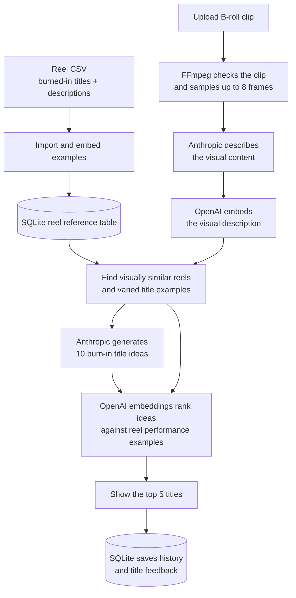

# B-Roll Title Generator

An experimental local-first app for creating burn-in title ideas for social media short-form videos. Upload a B-roll clip, such as footage from an Instagram creator, and the app analyses its visuals, finds similar reel examples, and suggests on-screen title text that fits the footage.

The app uses **Anthropic** to understand video frames and generate titles, **OpenAI** to create text embeddings, and **SQLite** to store the reel reference table, uploads, generations, and feedback locally.

## What it does

- Takes an MP4 or MOV B-roll clip and samples its frames to understand the scene, subject, setting, mood, and visual hook.
- Matches that visual description to popular and other relevant reel examples in a local table. The table stores extracted burned-in titles, visual descriptions, hook types, and available performance signals.
- Uses the matched examples as context for generating ten title candidates, then ranks them and presents the top five for review.
- Lets you steer the ideas and give feedback on titles. Saved likes can inform later generations on the same local app.
- Keeps the original video as reference footage. It suggests title text; it does not render the text onto the video.

Clips must be MP4 or MOV, no larger than 50 MB, and no longer than 60 seconds.

## How the pipeline works



The CSV import builds the reference table that gives generations reel examples to draw from. This is retrieval, not model training or fine-tuning: during import, the script classifies title hook types and creates OpenAI embeddings for reel titles and visual descriptions. During generation, the app embeds the new clip's description, compares it locally with the stored reel descriptions, and uses relevant examples to guide Anthropic. Without importing the CSV, title generation still works, but it has no reel examples for retrieval or corpus-based ranking.

## Architecture

- `app/` — Next.js pages and API routes for uploads, generation, history, and feedback.
- `components/` — upload, clip preview, history, and title review interface.
- `lib/media/` — upload preparation, FFmpeg probing, temporary files, and frame extraction.
- `lib/generation/` — coordinates visual analysis, embedding search, title generation, and ranking.
- `lib/providers/` — Anthropic vision and generation clients, plus OpenAI embeddings.
- `lib/db/` — initializes SQLite tables and performs local embedding similarity search.
- `lib/retrieval/` — searches reel examples, diversifies results, calculates title priors, and retrieves liked titles.
- `scripts/import-dataset.ts` — classifies and imports the reel CSV into SQLite.
- `datasets/` — the example reel CSV and instructions for its fields.

SQLite lives at `data/app.sqlite`; uploaded clips live in `data/uploads/`. Both are ignored by Git. Set `DATA_DIR` to put them in another persistent directory.

## Try it locally

Requirements: Node.js 22.13 or newer, npm, and API keys for Anthropic and OpenAI. Provider API usage may incur charges.

```bash
git clone <your-public-repository-url>
cd <repository-folder>
npm install
cp .env.example .env.local
```

Add your keys and a private cookie secret to `.env.local`:

```env
ANTHROPIC_API_KEY=your-anthropic-api-key
OPENAI_API_KEY=your-openai-api-key
COOKIE_SECRET=your-random-secret
# DATA_DIR=./data
```

Generate a random cookie secret:

```bash
node -e "console.log(require('crypto').randomBytes(32).toString('hex'))"
```

### Import the reel examples

Import the included CSV to populate the SQLite reel reference table and enable example-based retrieval:

```bash
npm run import:dataset -- --apply
```

This uses both provider APIs to classify titles and create embeddings, and may incur charges. The import replaces the rows in the local corpus table; it does not import video files or change generation history. To use a different reel dataset, replace `datasets/william-wade-titles.csv` with a CSV in the documented format.

### Start the app

```bash
npm run dev
```

Open <http://localhost:3000>, go to **Try the demo**, click **Enter**, and upload a B-roll clip.

## Data and privacy

Uploaded video files and app records stay on the machine running the app. Sampled video frames are sent to Anthropic for visual analysis. Text descriptions, reel text, and title candidates are sent to OpenAI for embeddings; raw frames are not sent to OpenAI by this pipeline. Review the providers' current API terms and privacy settings before processing sensitive footage.

Keep `.env.local` and `data/` private. Do not commit API keys, personal videos, or user data. The app is designed for local use or a server with persistent disk. Serverless hosts with temporary filesystems will not reliably retain the database or uploads. Add authentication, quotas, and abuse protections before exposing a shared deployment that uses your API keys.

## Development

```bash
npm run dev        # Run the development server
npm run typecheck  # Check TypeScript types
npm test           # Run the Vitest suite
npm run build      # Create a production build
```
